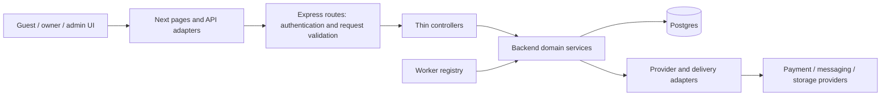
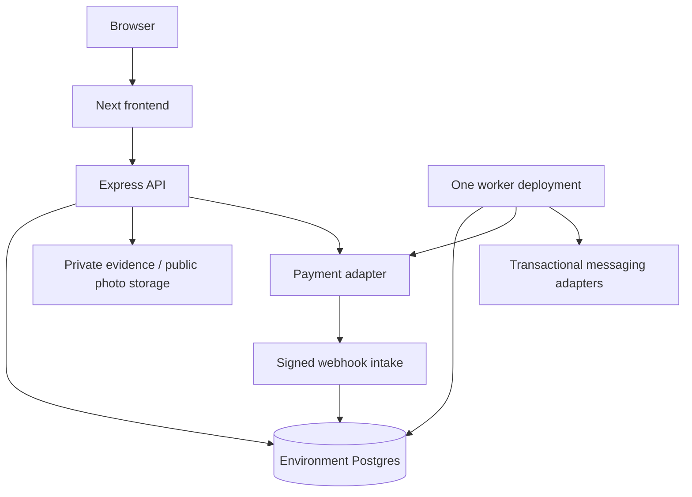

# Rentra launch architecture spine

## Design Paradigm

Retain the layered modular monolith: a Next.js frontend consumes the Express API; API and worker share backend domain services and Postgres. These are separately running processes, with one backend domain authority. Domain groups below designate ownership, not new deployable services. Existing routes and adapters remain the compatibility boundary.

This is a target consistency contract over existing code. **[ADOPTED]** identifies a rule inherited from approved requirements, user decisions or inspected conventions; it does not mean the whole rule is implemented. The final PRD and later approved addendum/register semantics remain binding; this compact contract does not replace them. Feature contracts must trace relevant FR/NFR acceptance cases. Known gaps and evidence are in [source evidence](source-evidence.md). This document is finalized for planning; affected financial architecture sign-off remains conditional on the named provider, funding and specialist gates. No infrastructure replacement or dependency upgrade is selected.

Browser code cannot import backend services or access the database. Domain services cannot depend on frontend components. Controllers and jobs invoke the same domain mutation paths; a job is not a second implementation of a business rule.

## Invariants & Rules

### AD-1 - Backend authority and API compatibility [ADOPTED]

- **Binds:** All frontend/backend features.
- **Prevents:** Two implementations charging or authorizing differently; independently deployed clients breaking.
- **Rule:** Backend owns authoritative eligibility, price, policy evaluation, authorization and mutations. Frontend validation is guidance, never authority. Keep the existing repositories; no shared package is introduced. Every changed API contract includes request/response examples, authorization, stable error codes, money units, state meanings and producer/consumer compatibility checks before dependent work. Preserve response envelopes, field errors, redirect/revalidation metadata and intentional streamed/webhook exceptions. Extend compatibly before retiring an old shape; record coordinated rollout when compatibility cannot be preserved. Never branch on human message text.

### AD-2 - Domain ownership and shared mutations [ADOPTED]

- **Binds:** All backend features and worker jobs.
- **Prevents:** Duplicate writers applying incompatible versions of one rule.
- **Rule:** Listing/review owns property revisions and approval; booking owns quotes, accepted terms and reservations; payments owns verified captures/refunds; finance owns payout eligibility, responsibility adjustments and recovery obligations; notifications owns delivery attempts, not business entitlement. Planned recovery joins backend finance, not a new service. Cross-domain actions use their owning services within a caller-supplied transaction when atomicity is required. Only the owning service defines transitions; readers do not mutate state while formatting it. Exact files remain code-owned.

### AD-3 - Inventory serialization and admission [ADOPTED]

- **Binds:** FR-6, FR-8, FR-18, FR-22, FR-23; all inventory writers.
- **Prevents:** Overselling, reclaimed expired holds and publication/debt bypasses.
- **Rule:** Reuse the listing-inventory mutation protocol for quotes that reserve, owner calendar edits, approval, expiry, confirmation and cancellation. Preserve its listing -> sorted orders -> visits -> sorted reservations lock order and bounded whole-transaction retries for serialization/deadlock errors. No provider call occurs inside that transaction. Admission must also serialize against owner-wide blocking changes, with an owner guard acquired before listing locks wherever both are needed. Multi-listing actions acquire listing locks in stable ID order. Every admission/confirmation checks current publication, owner restrictions, eligibility and stock under the same guards. Owner admission evaluates canonical overdue debt and receipt-based deadlines at authoritative database time; a stale worker-maintained restriction projection cannot permit a blocked admission. Worker outage does not relax this gate. Search is advisory; a stale public page confers no booking entitlement. Hotel quantity is room-type/night capacity; apartment inventory is one exclusive whole unit with configured buffers.

### AD-4 - Accepted terms and stale previews [ADOPTED]

- **Binds:** FR-8-18, FR-20, FR-22-24.
- **Prevents:** Policy edits rewriting paid bookings; confirmations executing different consequences from preview.
- **Rule:** Accepted bookings retain authoritative component amounts/allocations, effective fee and policies, room/night scope, party ages/pets, property timezone/schedule, and configuration/source versions. Resolve hotel cancellation policy from the property default unless an explicit rate-plan override replaces it; room type/meal inclusion alone does not require another policy. New invalid unpaid quotes require a fresh guest review; accepted bookings keep their terms. Consequential preview/confirm commands bind actor, action, affected records, amounts and relevant versions using a server-verified digest/version; reject changed consequences for fresh review. Frontend submits selection/reference and consent, not trusted payable amounts. Later actions use booked terms, not edited listing prices.

### AD-5 - Monetary representation and allocation [ADOPTED]

- **Binds:** All price, refund, payout, recovery and statement features.
- **Prevents:** Unit conversion errors, lost paise and incompatible partial refunds.
- **Rule:** Monetary computation uses integer paise with checked bounds; explicit `Minor` values and currency cross APIs. Preserve existing legacy-major conversion at the existing booking-money boundary; do not reinterpret legacy columns. Percentage settings have an explicit scale. Calculate Rentra's one service fee on rental plus paid extras before tax; global launch default 5%, authorized owner-wide override replaces it. Ordinary gateway expense belongs to Rentra. Allocate shared charges by booked room price using stable largest remainder and deterministic line-ID tie order; zero-price lines receive zero share, and nonzero charges with all-zero weights require an explicit basis or validation failure. Persist allocations; never redistribute onto retained rooms/nights during refunds. Tax/remittance accounting remains gated.

### AD-6 - Verified payment, distinct state and environment [ADOPTED]

- **Binds:** FR-7, FR-11, FR-13-15, FR-20, FR-23-24.
- **Prevents:** Approval or client success masquerading as confirmation; Test activity masquerading as bank money.
- **Rule:** Keep booking, owner approval, payment, refund, payout and recovery states distinct. Manual approval enables full payment; it does not confirm a booking. Verified capture plus valid guarded inventory/eligibility enables confirmation. Ineligible late capture enters resolution and applicable refund work without reacquiring sold inventory. Pin provider configuration/environment to the attempt; scope provider IDs and events by provider/environment. Before applying a verified money outcome, match provider account/environment, operation and local/provider references, currency, expected amount and authoritative result state. A valid signature alone is insufficient. Preserve mismatched/excess or unlinked movement evidence for exception reconciliation rather than silently applying or discarding it. Simulated, Test and Live facts cannot be mixed; Test actual bank collection/payout/recovery stays zero. Gateway disablement blocks new attempts, while pinned existing attempts and obligations remain reconcilable. Existing order state labels need not be renamed to achieve this separation.

### AD-7 - Durable financial intents and event processing [ADOPTED]

- **Binds:** Payment, refund, payout, recovery, worker and provider integrations.
- **Prevents:** Crash-created duplicates, blind retries and out-of-order callbacks reversing verified outcomes.
- **Rule:** Persist each authorized movement intent and its reserved amount atomically with the domain decision, before dispatch. Use actor/scope-bound idempotency key plus canonical request hash; replay returns the recorded outcome, while a changed payload conflicts. Dispatch outside the transaction through existing durable job/operation patterns. Verify raw signed webhook bytes before normalization; atomically deduplicate and persist an event plus processing work before success acknowledgement. Worker claims are durable and fenced locally; persist dispatch identity before network I/O and reuse the same provider-supported idempotency identity for a movement. Lease expiry does not prove a call was unsent: takeover of potentially dispatched work is uncertain and requires reconciliation before another create. If the provider lacks safe duplicate prevention/reconciliation, automatic redispatch is disabled and an exception path is required; retain its reservation. Repeated/out-of-order events reconcile provider facts against current state. Timeout is unknown, not failed. Retain the original operation identity and reconcile before retrying an uncertain movement. No exactly-once network guarantee is assumed.

### AD-8 - One coordinated booking obligation [ADOPTED]

- **Binds:** FR-7, FR-9-15, FR-20; NFR-2.
- **Prevents:** Concurrent payout/refund overcommitment and double owner collection.
- **Rule:** Serialize all money decisions for an order through its current obligation and ordered locking protocol. Refund capacity counts completed plus reserved initiated/uncertain refunds and reconciled reimbursements through disputes/reversals against verified paid money. Link bank disputes to their provider-deadline exception workflow; money already returned by another channel cannot be refunded again. Payout initiation follows verified capture plus confirmed-booking/owner/provider eligibility, without waiting for check-in or checkout. Authorized admin controls global Auto/Manual (launch default Auto) and optional owner-wide override; override replaces global mode. Both modes use identical eligibility. Recheck current mode/eligibility for queued uninitiated work; changing mode neither cancels nor duplicates initiated/uncertain transfers. Payout eligibility counts current refund/cancellation decisions and all initiated/uncertain transfers; cancellation/refund approval prevents an incompatible new payout. Reconcile late transfer results rather than assuming a cancellation stopped them. Recovery accounts for actual prior payout/refund and verified recovery allocations; its capacity reserves in-flight/uncertain collections against remaining assigned debt. No negative entitlement, duplicate recovery, cross-booking payout offset or automatic owner-bank debit. Zero guest due records a no-money result and creates no zero-value provider refund.

### AD-9 - Guest entitlement and responsibility are separate [ADOPTED]

- **Binds:** FR-7, FR-9-11, FR-14, FR-20.
- **Prevents:** Liability reassignment becoming a second guest refund or silently rewriting history.
- **Rule:** Ordinary cancellation percentages apply to the affected scope's full booked paid components, including rental, Rentra fee, taxes and paid extras, with proportional owner/Rentra responsibility. Confirmed policy-entitled cancellation automatically initiates its eligible refund without routine admin review; the unused-night early-departure exception remains AD-10. Reviewed owner-funded responsibility is a separate incident exception. Admin incident percentages are cumulative guest-refund targets; pay only the additional unrefunded amount, respecting AD-8 reservations. Preserve proportional versus owner-funded responsibility separately from guest money movement. Audited cumulative owner-funded reassignment may include earlier refunds and liability above owner proceeds; record adjustment, reason, actor and prior/new allocation without overwriting prior ledger facts or paying the guest twice. Lower targets do not claw back guest money. Owner cancellation targets full paid entitlement including earlier refunds. Owner recovery follows completed Rentra-funded refunds and verified owner proceeds/assigned responsibility; it does not delay guest entitlement or undo a completed guest refund. Enforceable consent/accounting and actual funding remain release gates.

### AD-10 - Scope and time boundaries [ADOPTED]

- **Binds:** Cancellation, hotel/apartment allocation, approval and inventory release.
- **Prevents:** One room's policy changing another room or elapsed-time cutoffs being interpreted differently.
- **Rule:** Use booked property timezone/check-in schedule plus authoritative request time; retain local dates separately from UTC instants. At an exact cancellation cutoff use the at/after rule. Mixed-room cancellation evaluates each selected room's effective booked policy and allocated components; retain other rooms unchanged. Confirmed voluntary early departure affects only unused nights whose starts are strictly later than the confirmed request; current/commenced nights are consumed, without hourly proration. Release only affected future inventory. Owner bulk upcoming cancellation uses check-in strictly in the future; separate unpaid requests from confirmed bookings and reconcile raced captures. Preserve up-to-24-hour manual response then 12-hour payment windows capped by arrival; setting changes do not convert existing requests.

### AD-11 - Composed publication and debt restrictions [ADOPTED]

- **Binds:** FR-1-6, FR-14, FR-23.
- **Prevents:** An owner toggle bypassing verification or one debt payment clearing unrelated restrictions.
- **Rule:** Derive sellability from distinct owner verification, property approval, required setup, pause/admin restrictions, owner debt restriction and date inventory. A material reviewed-identity/unit/location change cannot inherit inaccurate verification. Draft save never submits corrections; explicit resubmission creates the review transition. Preserve reasoned review history and evidence-backed claims. Recovery debt is per obligation: day 5 reminder/day 7 due derives from earliest verified confirmed delivery or authenticated notice view/acknowledgement; otherwise recorded admin confirmation of receipt is required. Preserve evidence/history and canonical receipt timestamp. Reconcile late earlier verified evidence as an audited correction of that same clock and milestones, never a replacement-link reset; evaluate subsequent admission against the corrected deadline without cancelling already-confirmed bookings. Late-evidence/reminder-order cases require feature acceptance tests. Send success alone cannot start blocking. Link replacement/expiry does not reset the clock. Owner-wide new-booking restriction remains while any overdue blocking balance remains; verified full repayment clears only the debt restriction. Preserve existing bookings and other restrictions. Reconcile excess/in-flight repayments without revenue recognition or automatic cross-debt allocation.

### AD-12 - Authorization, evidence and audit [ADOPTED]

- **Binds:** NFR-1, NFR-4; all private surfaces and mutations.
- **Prevents:** Cross-owner/account leakage, public private evidence and UI-only finance permissions.
- **Rule:** Resolve current identity, record ownership and required capability in backend reads and commands. Public projections exclude identity documents, internal case notes, private contact/evidence and bank/provider secrets. Private file access requires authorization and bounded access; preserve existing approved disclosure rules. Log sensitive decisions with actor/system trigger, reason, affected IDs, versions, amounts and transition, without secrets or unnecessary personal data. Internal-note commands remain private and cannot change case, booking or financial status; public replies and authorized status/financial commands are distinct operations. Receipt evidence is restricted and attributable. Retain existing step-up and session protections for sensitive actions. Retention/deletion must preserve required financial/audit evidence under validated policy; no new retention period is invented.

### AD-13 - Durable notifications and scheduled work [ADOPTED]

- **Binds:** Verification, support, reviews, recovery and worker operations.
- **Prevents:** Sent email being treated as received notice, missed actions after restart and duplicate reminders.
- **Rule:** Commit domain state and required notification intent together. Portal is the durable request record; transactional email is a separately tracked delivery. Delivery failure cannot roll back guest entitlement or imply owner response. Key scheduled work by subject/request, milestone and version; calculate due work from persisted business timestamps, not process uptime. Correction reminders are at elapsed days 7/15/30 and stop after resubmission/closure; review window is 30 days with day-7 reminder; issue reporting target is 72 hours from discovery with exceptions. Denied access, safety and currently stranded cases create immediate automated routing/escalation independently of owner response; report intake does not itself cancel or refund. Human first response target is 12 elapsed hours, separate from resolution, with truthful urgent contact options. Use the existing registry/worker with durable claims, retries and visible terminal failures; horizontal worker scaling requires proven fencing, not a second uncoordinated scheduler. Reviews publish after ordinary booking eligibility/content checks; flagged/reported content goes to reasoned admin moderation. Arrival/access exceptions require reviewed case-linked eligibility. Owners cannot veto/delete a review, and negativity alone is not a removal reason. Staffing remains an operating gate.

### AD-14 - UI projections and cache isolation [ADOPTED]

- **Binds:** All role surfaces; NFR-5.
- **Prevents:** Cached identity data leaking or UI polish changing financial semantics.
- **Rule:** Render authoritative totals, effective policies, separate state facts and permitted actions through existing adapters. No optimistic success for finance, booking, approval or permission changes. Private caches are scoped to identity/role and cleared on identity changes; public cache contains only public projections. Revalidate affected views after acknowledged commands and revalidate stock/price before writes. Preserve valid trip/form context safely across auth recovery. Keep assistance-animal intake separate from ordinary pets; do not automatically block or charge it under ordinary pet rules. Applicable accommodation/exemption/documentation handling remains specialist-gated. Use finalized DESIGN/EXPERIENCE and the existing design system; approved mockups remain references. Accessibility, keyboard/focus, responsive images and performance budgets apply to complete flows, not just isolated controls. No offline money/inventory queue is introduced.

### AD-15 - Deployment, migration and operational isolation [ADOPTED]

- **Binds:** Frontend, API, worker, database and external adapters.
- **Prevents:** Split deployments corrupting contracts or Test work triggering Live actions.
- **Rule:** Keep separate frontend/API/worker processes and environment-specific database, provider credentials, webhook and storage/delivery configuration. Browser bundles contain no secrets. Deploy compatible backend/schema expansion before dependent frontend/worker use; run explicit forward Drizzle migrations separately from application startup, preserving applied history and schema-source consistency. Destructive/data-conversion changes need their own reviewed migration and recovery plan. Code rollback must remain compatible with retained schema/history and cannot erase settled movements. Keep live financial initiation gated until provider, funding, specialist and hosted acceptance evidence is recorded; disabled initiation must leave investigation/reconciliation available. Operations must surface stale worker heartbeats, aged unknown movements, delivery failures, exposure and restriction failures with an assigned responder. Host choice, restore drills and measured capacity are deployment acceptance work, not certified here.

## Consistency Conventions

| Concern | Convention |
| --- | --- |
| API | Existing `/api/v1` routes/envelopes and intentional exceptions; additive contract changes; backend request validation plus consumer examples/checks. |
| Identity | Existing opaque IDs and references; actor/owner/environment must come from trusted context, not an unchecked form field. |
| Money | Integer paise, currency, explicit percentage scale; legacy major-unit conversion only at existing conversion boundary. |
| Time | UTC instants plus booked IANA property timezone and local schedule; elapsed days for operational deadlines; never browser timezone. |
| Errors | Stable machine code, field errors and recoverable context; unknown provider outcome is distinct from verified failure. |
| History | Append attributable transitions/adjustments; preserve original accepted terms and operation identities. |

## Stack

Installed seed inspected 26 October 2026; exact code/lockfiles own upgrades. These are retained local versions, not claims of latest releases. `postgres` below is the JavaScript client; database server version remains a deployment check.

| Name | Version |
| --- | --- |
| Next.js | 16.3.4 |
| React | 19.2.8 |
| Tailwind CSS | 4.3.3 |
| Redux Toolkit / RTK Query | 2.12.0 |
| Express | 4.22.3 |
| Drizzle ORM | 0.45.3 |
| postgres client | 3.4.9 |
| Backend Zod | 4.6.5 |

## Structural Seed

Retain the current provider adapters. Route/transfers and repayment-link capabilities are candidates requiring account-specific validation, not selected Live integrations. Environment-specific connections, permitted origins/cookies and private/public media boundaries must be configured and tested before hosting. No new broker, search engine or independently deployed finance service is required by this contract.

| Feature group | Ownership boundary | Known target work |
| --- | --- | --- |
| Listing/review | Existing auth/listing, review and upload services | Explicit correction/resubmission history, readiness and evidence distinctions. |
| Catalog/booking | Existing booking/domain and hotel services | Approved child/pet/bedding policies, whole apartments, complete facilities and configured cancellation windows. |
| Payment/finance | Existing payments/finance with planned recovery domain | Hotel fee and payout mismatch, coordinated cumulative allocations, audited debt and receipt evidence. |
| Guest/support | Existing customer, disputes and reviews | Incident remedies, arrival/access review eligibility, status and reporting rules. |
| Notifications/operations | Existing jobs, notifications and operations | Approved durable notice schedules, receipt evidence, finance/exposure queues and runtime acceptance. |

## Capability to Architecture Map

| Capability / area | Lives in | Governed by |
| --- | --- | --- |
| UJ-1; FR-1-6 | Owner listing/review, publication and notifications | AD-1-4, AD-11-15 |
| UJ-2; FR-8, FR-16-18, FR-22-24 | Discovery, quotes, selection, inventory and guest account | AD-1-6, AD-10, AD-12, AD-14 |
| FR-7, FR-9-12 | Cancellation, quote/policy allocation and refunds | AD-4-10, AD-12-15 |
| UJ-3; FR-19-21 | Support, incident finance, reviews and evidence | AD-4, AD-7-10, AD-12-14 |
| UJ-4; FR-13-15 | Payouts, refunds, recovery and owner restrictions | AD-5-9, AD-11-15 |
| NFR-1-5 | All groups and operational acceptance | AD-1-15 |

## Deferred and Evidence Gates

| Item | Owner / revisit condition |
| --- | --- |
| Actual reserve funding, exposure ceiling/monitor and action before exceeding it; INR 40,000 is only a proposal | Founder/finance; must resolve before affected financial architecture/implementation sign-off and Auto payout/refund launch. No cap or funding commitment inferred. |
| Live capture/transfer/refund/repayment adapters, old-payment limits, disputes and receipt-channel capabilities | Engineering + founder/provider; demonstrate account-specific capabilities and signed hosted Test acceptance before affected financial architecture sign-off; separate Live enablement approval. |
| Tax/invoice/remittance, refund allocation accounting, owner liability terms and evidence retention | Appropriate India accounting/legal/privacy specialists + founder; before affected financial/policy acceptance. |
| Support hours, urgent escalation and accountable on-call coverage | Founder/operations; before real guest support launch. No 24/7 staffing claim. |
| Authority-document sufficiency, child check-in eligibility, cot inventory, apartment duration, assistance-animal handling | Operations/product with owners/specialists; before relevant category/policy release. Existing approved product rules remain binding. |
| Exact additive request/schema shapes, lock guard/table design, line-ID allocation tie fixture, provider claim/retry implementation | Feature-level architecture/stories; must satisfy AD-1-15 and existing inventory protocol before parallel implementation. Publish shared contracts first; these details cannot be independently guessed. |
| Hosting/region, Postgres server version, backup/restore and schema recovery drills, production secrets/origins, numeric alerts/load capacity | Engineering/operations; inspect actual infrastructure and record deployment acceptance before release. No host migration is selected. |
| Full journey tests, disposable-DB concurrency/rollback cases, actual iOS/Android/screen-reader checks, WCAG and CWV measurements | Engineering/QA/UX; before release. Targets are PRD NFR-5 and EXPERIENCE; historical mock checks are not runtime evidence. |

Exact data shapes and migration SQL belong to feature contracts, not this initiative document. No deferred item waives a shared invariant or authorizes a provider transaction, migration, deployment or automatic commercial-policy change.
